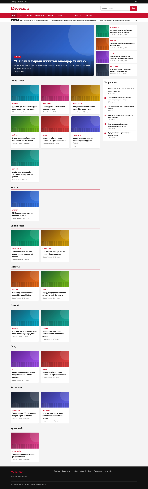
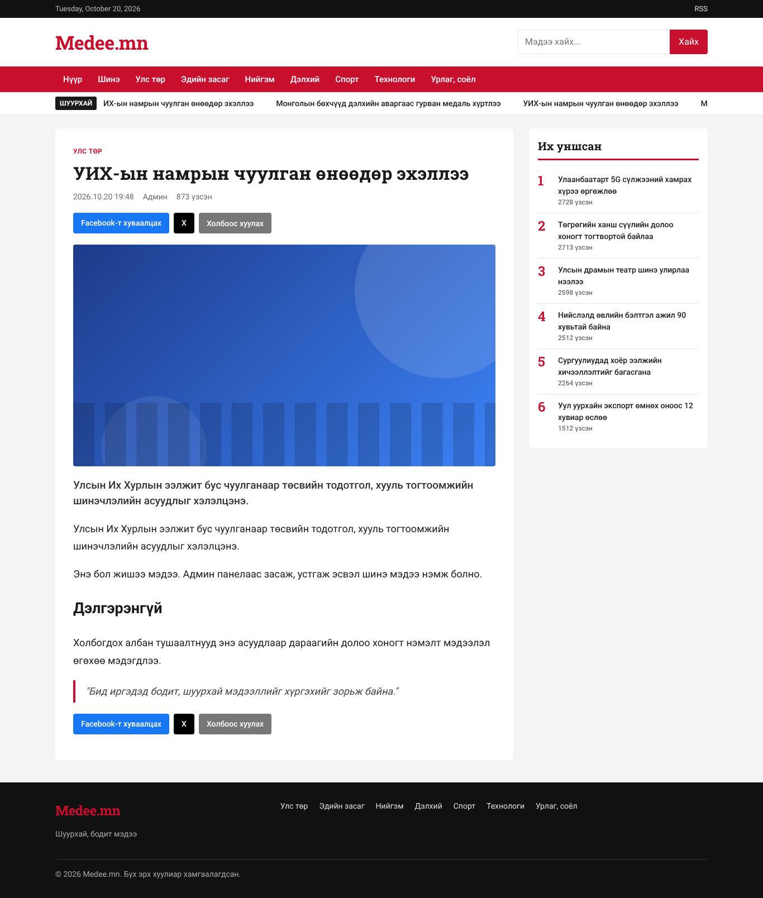
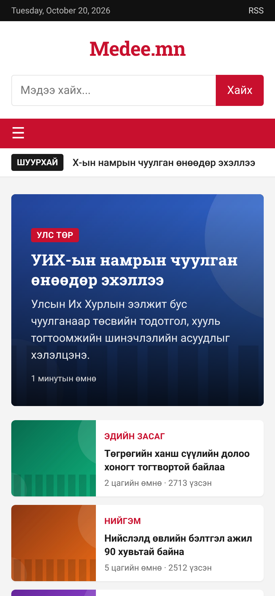
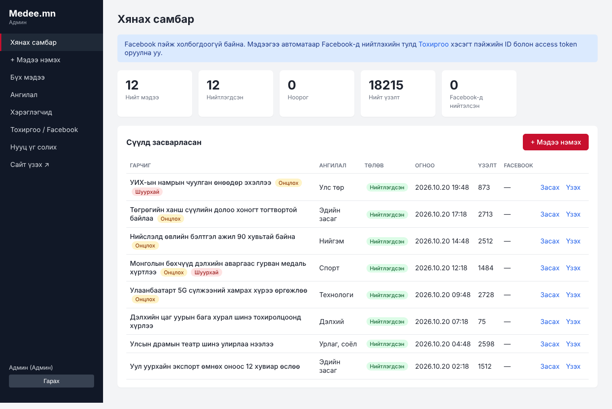
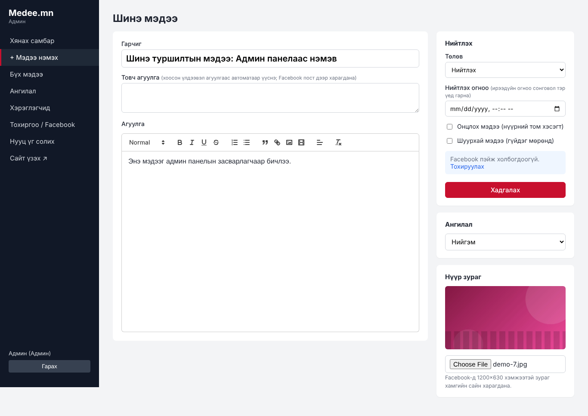
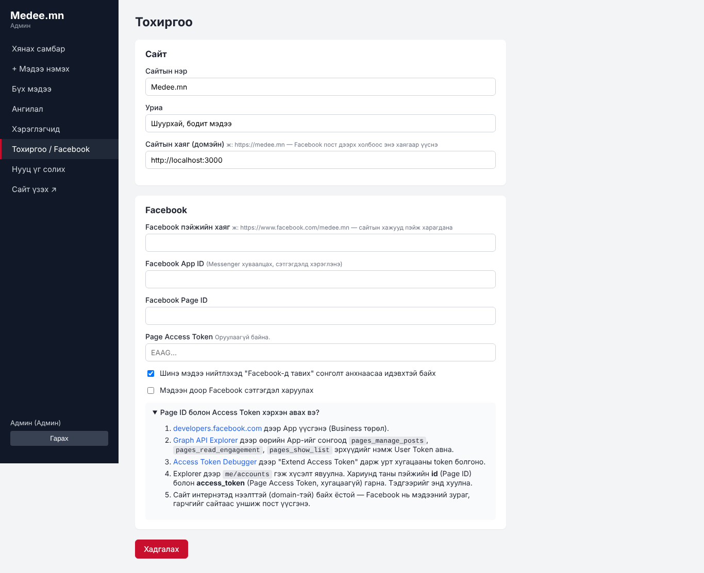

# Medee.mn — Мэдээллийн сайт + Админ панел + Facebook

Хоёр хувилбартай: **`php/`** — PHP 7.4+/MySQL (энгийн cPanel хостинг), үндсэн хавтас — Node.js.

news.mn, record.mn, zarig.mn маягийн мэдээллийн сайт. Мэдээгээ админ панелаас оруулна, нийтлэх үед Facebook пэйж дээр автоматаар тавигдана.

## Боломжууд

**Сайт (уншигчдад)**
- Нүүр хуудас: онцлох мэдээ (том зураг), шинэ мэдээ, ангилал бүрийн хэсэг
- "Шуурхай" мэдээний гүйдэг мөр, "Их уншсан" (7 хоногийн) жагсаалт
- Ангилал, хайлт, хуудаслалт, RSS (`/rss.xml`)
- Мэдээний хуудас: үзэлтийн тоо, холбоотой мэдээ, Facebook / Messenger / X хуваалцах товч
- Facebook Open Graph тагууд — линк хуваалцахад зураг, гарчиг гоё харагдана
- Facebook пэйжийн цонх, Facebook сэтгэгдэл (сонголтоор)
- Утсанд тохирсон (responsive)

**PHP хувилбарын нэмэлт боломжууд:** time.mn маягийн дизайн (админаас өнгө, лого, footer тохируулна), Бидний тухай / Холбоо барих хуудсууд, сурталчилгааны баннер (харагдсан/дарсан тоо), зурган дээр автоматаар лого (watermark), өдөр бүрийн үзэлтийн график, хамгийн их уншигдсан мэдээ, уншигчийн сэтгэгдэл (админ шалгах боломжтой), валютын ханш, Улаанбаатарын цаг агаар, зургийг автоматаар жижигрүүлэх, sitemap.xml, robots.txt, Google Analytics, Search Console.

**Админ панел (`/admin`)**
- Мэдээ нэмэх / засах / устгах, текст засварлагч (зураг, видео, холбоос оруулна)
- Нүүр зураг хуулах, ноорог / нийтлэх, ирээдүйн огноонд товлон нийтлэх
- Онцлох, шуурхай мэдээ тэмдэглэх
- Ангилал удирдах, хэрэглэгч (админ / редактор) нэмэх, нууц үг солих
- **Facebook:** нийтлэхэд пэйж дээр автоматаар пост тавих, эсвэл "Facebook-д одоо нийтлэх" товч

## Зураг

| Нүүр хуудас | Мэдээ | Утас |
|---|---|---|
|  |  |  |

| Хянах самбар | Мэдээ нэмэх | Facebook тохиргоо |
|---|---|---|
|  |  |  |

## Ажиллуулах

**Энгийн cPanel хостинг (PHP + MySQL) дээр тавих бол `php/` хавтсыг ашиглана → [CPANEL.md](CPANEL.md) заавар.**

### Node.js хувилбар

Node.js 18 буюу түүнээс шинэ хувилбар хэрэгтэй. Node 22.13+ дээр суурилагдсан SQLite-ийг ашиглана, түүнээс хуучин хувилбар дээр `better-sqlite3` сан автоматаар суулгана.

```bash
npm install
npm run seed      # (заавал биш) жишээ мэдээ нэмэх
npm start
```

- Сайт: http://localhost:3000
- Админ: http://localhost:3000/admin — анхны нэвтрэх нэр `admin`, нууц үг `admin123` (**заавал солино уу**)

Тохиргоог `.env.example` файлаас харна уу (`SESSION_SECRET`, `ADMIN_USER`, `ADMIN_PASSWORD`, `PORT`, `SITE_URL`). Өгөгдөл `data/`, хуулсан зургууд `uploads/` хавтаст хадгалагдана — серверээ шилжүүлэхдээ эдгээрийг нөөцөлнө үү.

## Facebook-тэй холбох

1. https://developers.facebook.com/apps дээр App үүсгэнэ.
2. Graph API Explorer дээр `pages_manage_posts`, `pages_read_engagement`, `pages_show_list` эрхтэй token авч, Access Token Debugger дээр урт хугацааны болгоно.
3. Explorer дээр `me/accounts` гэж хүсэлт явуулж, пэйжийнхээ `id` болон `access_token`-г авна.
4. Админ > **Тохиргоо / Facebook** хэсэгт Page ID, Page Access Token, сайтын хаягаа (жишээ нь `https://medee.mn`) оруулна.

Үүний дараа мэдээ нийтлэх бүрд Facebook пэйж дээр гарчиг, товч агуулга, линктэй пост автоматаар гарна. Facebook нь зураг, гарчгийг сайтаас уншдаг тул сайт интернэтэд нээлттэй, домэйнтэй байх ёстой.

## Бүтэц

```
server.js            Express сервер
src/db.js            SQLite хүснэгтүүд, анхны өгөгдөл
src/routes/public.js Уншигчийн хуудсууд
src/routes/admin.js  Админ панел
src/facebook.js      Facebook пэйж рүү нийтлэх (Graph API)
views/               EJS загварууд
public/              CSS, JS
```
